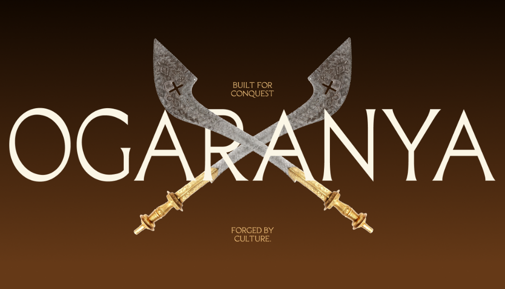
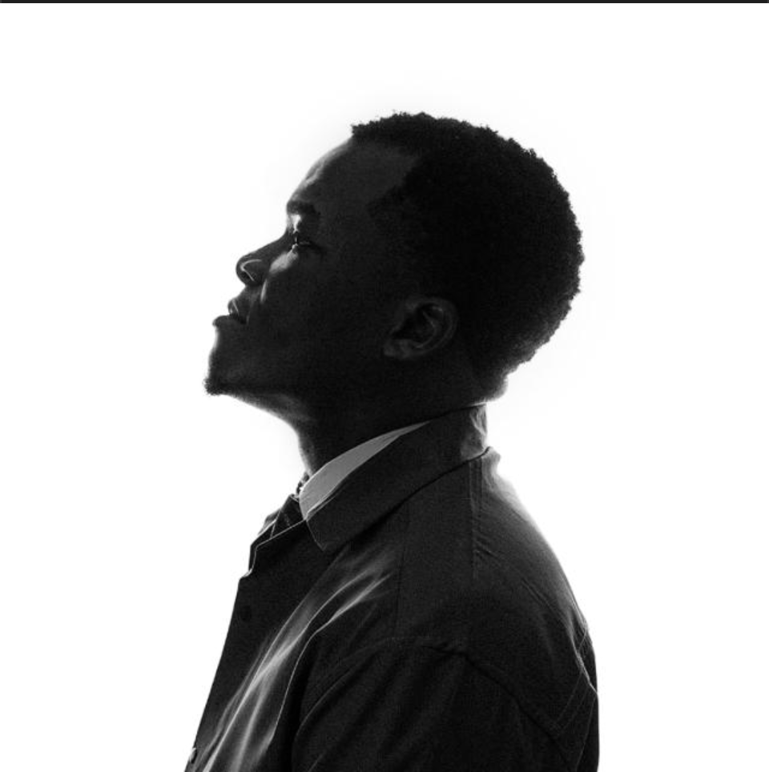

<div align="center">

  

  <br /><br />

  # **OGARANYA**
  ### *Built For Conquest. Forged By Culture.*

  <p align="center">
    An immersive, award-winning digital specimen and heritage exhibition for <strong>OGARANYA</strong> — a high-contrast African display serif typeface inspired by the visual authority, regal ceremonial weaponry, and empires of the African continent.
  </p>

  <p align="center">
    <a href="https://nextjs.org"></a>
    <a href="https://react.dev"></a>
    <a href="https://www.typescriptlang.org"></a>
    <a href="https://tailwindcss.com"></a>
    <a href="https://gsap.com"></a>
    <a href="https://lenis.darkroom.engineering"></a>
  </p>

  <p align="center">
    <a href="#about-the-typeface">The Typeface</a> •
    <a href="#interactive-features">Interactive Features</a> •
    <a href="#specifications">Specifications</a> •
    <a href="#tech-stack">Tech Stack</a> •
    <a href="#project-structure">Architecture</a> •
    <a href="#getting-started">Getting Started</a> •
    <a href="#licence">Licence</a> •
    <a href="#credits">Credits</a>
  </p>

</div>

---

## 🗡️ About the Typeface

> *"Ogaranya is a typeface born from the idea of power, wealth, kingship, and conquest."*

The visual language of African kingdoms was defined by sharp ceremonial blades, commanding spears, carved shields, and royal regalia carried by monarchs and warriors who defended and expanded their sovereign domains. 

**OGARANYA** translates these historic forms directly into typography:
- **Decisive Cuts**: Razor-sharp serifs reminiscent of ceremonial swords.
- **Regal Architecture**: Monumental stem proportions and striking high-contrast transitions.
- **Pan-African Panache**: Full character sets extending beyond Western European orthographies to embrace written African languages—including **Igbo**, **Yoruba**, and **Hausa**—giving native African tongues the same visual majesty traditionally reserved for classical display serifs.

---

## 🏛️ Typeface Specifications

| Specification | Details |
| :--- | :--- |
| **Type Design & Production** | **Nebo Ikechukwu Kingsley** ([@uncle_nebo](https://x.com/uncle_nebo)) |
| **Creative Engineering** | **Daniel Nwachukwu** ([@dannyclassi_c](https://x.com/dannyclassi_c)) |
| **Release Date** | November 2026 |
| **Version** | `v0.1` |
| **Glyph Composition** | **830 Glyphs** (Latin Extended, Diacritics, Ligatures, Numerals, Symbols) |
| **Language Support** | Latin Extended, 1,000+ languages (Igbo, Yoruba, Hausa, English, French, Swahili, etc.) |
| **Available Formats** | `OTF`, `TTF`, `WOFF`, `WOFF2` |
| **Licence** | Free for Personal and Commercial Use ([View Licence](public/fonts/Ogaranya_Font_Licence.txt)) |

---

## ✨ Interactive Digital Exhibition Features

The website is engineered not merely as a font landing page, but as a bespoke digital exhibition built with artisanal motion design and micro-interactions:

### 1. ⚔️ Pinned Runway & Hero Zoom Transition
- Pinned `300%` viewport runway driven by **GSAP ScrollTrigger** and **Lenis**.
- Crossed ceremonial swords rotate outward and glide away into the margins on forward scroll.
- The monumental display typography zooms continuously into the golden letter **`A`**, seamlessly revealing the heritage story behind it.
- Bidirectional scroll lock ensures pristine 1:1 state resets with zero graphical artifacts on rapid reverse scroll.

### 2. 📜 Heritage Story Inking
- Pinned narrative layer unfolding the history, inspiration, and African lineage of the typeface.
- Progressive line-by-line inking effect transitioning from faint ghost ink (`opacity: 0.12`) to solid obsidian black (`opacity: 1.0`) synchronized with user scroll velocity.

### 3. 🖼️ Visual Specimens & Artifact Collages
- Dual-column curations pairing glyphs (`I`, `JJ`, `O`, `?`) directly alongside historic African weapon and art collages.
- Smooth responsive layout with tailored single-column sequence on mobile viewports.

### 4. 🎴 Curated Poster Stack
- Rich showcase of 12 editorial posters featuring Nigerian proverbs, royal proclamations, and dramatic typographic layouts.
- Interactive randomization and swap controls allowing visitors to explore alternative poster pairings in real time.

### 5. 🔍 830-Glyph Interactive Explorer
- Searchable and categorised glyph table (Uppercase, Lowercase, Ligatures, Accented Glyphs, Numerals, and Symbols).
- Interactive glyph cards with live click-to-preview modal and Unicode clipboard copy.

### 6. ✍️ Real-Time Type Tester Sandbox
- Live in-browser specimen playground.
- Sliders for custom font size, letter spacing, line height, and alignment.
- Preset pangrams featuring English and authentic African proverbs in Igbo, Yoruba, and Hausa.

### 7. 🎨 Tri-Variant Card Generators
- **Variant 1**: Minimalist cream editorial card with text swapping and randomize actions.
- **Variant 2**: Gradient typographic cards featuring decisive cuts and edge-aligned imagery.
- **Variant 3**: Dark aesthetic poster cards with dual image-and-copy shuffle.

### 8. 🌀 Infinite Marquee & Cursor-Tracking Download Banner
- Endless animated `"TRY OGARANYA"` marquee.
- Interactive cursor-following circular `"Download"` badge with smooth physics.
- Directly serves the zipped font bundle (`/ogaranya_font/OGARANYA-Font.zip`).

### 9. 👑 Dynamic Creator Spotlight Footer
- Hover-reveal cursor blobs spotlighting **Uncle Nebo** and **DevDanny** with Twitter/X redirections.
- Animated mobile bottom-sheet popovers providing tactile click-to-view experiences on touch devices.

---

## 🛠️ Tech Stack

- **Framework**: [Next.js 15](https://nextjs.org/) (App Router, React Server Components)
- **UI Library**: [React 19](https://react.dev/)
- **Language**: [TypeScript](https://www.typescriptlang.org/) (Strict Mode)
- **Styling**: [Tailwind CSS](https://tailwindcss.com/) with custom typography utilities
- **Animation & Scroll Hijacking**:
  - [GSAP 3](https://gsap.com/) & [ScrollTrigger](https://gsap.com/scrolltrigger/)
  - [Lenis](https://lenis.darkroom.engineering/) (Inertia Virtual Smooth Scrolling)
- **Icons**: [Lucide React](https://lucide.dev/)
- **Media Optimization & Generation**: [Sharp](https://sharp.pixelplumbing.com/) & Next.js `ImageResponse`

---

## 📁 Project Structure

```text
OGARANYA/
├── public/
│   ├── fonts/                   # Webfont binaries (woff2, woff, ttf, otf)
│   ├── ogaranya_font/           # Distributable ZIP font bundle
│   ├── images/
│   │   ├── hero/                # Crossed ceremonial swords & emblems
│   │   ├── visuals/             # Weapon & heritage collage assets
│   │   ├── posters/             # High-res specimen poster stacks
│   │   └── social/              # Creator portraits & credits
│   ├── favicon.ico              # Scaled gold display "O" icon
│   └── og-image.png             # 1024×588 OpenGraph social banner
│
├── src/
│   ├── app/
│   │   ├── layout.tsx           # Global HTML shell, fonts, SEO & OpenGraph metadata
│   │   ├── page.tsx             # Main exhibition page orchestration
│   │   ├── icon.tsx             # Satori dynamic 48x48 PNG favicon (Ogaranya "O")
│   │   ├── apple-icon.tsx       # Dynamic 180x180 Apple Touch Icon
│   │   └── globals.css          # Tailwind base, custom fonts, grain overlays
│   │
│   ├── components/
│   │   ├── Navbar.tsx           # Responsive blurred header with dynamic theme switching
│   │   ├── HeroSection.tsx      # Pinned crossed-sword runway & zoom-in transition
│   │   ├── StorySection.tsx     # Narrative heritage & technical specs inking
│   │   ├── WeaponsSection.tsx   # Dual-column glyph & artifact collage gallery
│   │   ├── PosterSection.tsx    # Interactive poster grid & shuffle
│   │   ├── ShowcaseSection.tsx  # Editorial typography spreads
│   │   ├── GlyphsSection.tsx    # 830-glyph explorer with unicode modal
│   │   ├── SpecimenTesterSection.tsx # Live editable type tester sandbox
│   │   ├── CardGeneratorSection.tsx  # Card generator (Light Editorial)
│   │   ├── CardGeneratorSection2.tsx # Card generator (Gradient Cut)
│   │   ├── CardGeneratorSection3.tsx # Card generator (Dark Poster Stack)
│   │   ├── InteractiveTypeTesterSection.tsx  # Large headline tester
│   │   ├── InteractiveTypeTesterSection2.tsx # Secondary contrast tester
│   │   ├── TryOgaranyaSection.tsx    # Infinite marquee with cursor download badge
│   │   ├── FooterSection.tsx    # Dynamic credits, Twitter links & footer pattern
│   │   └── SmoothScroll.tsx     # Lenis + GSAP RAF synchronization wrapper
│   │
│   └── data/
│       └── glyphsData.ts        # Comprehensive glyph inventory dataset
│
├── tailwind.config.ts           # Typography tokens, font-family mappings
├── tsconfig.json                # TypeScript compiler config
└── package.json                 # Project dependencies & scripts
```

---

## 🚀 Getting Started

### Prerequisites
- **Node.js**: `18.18+` or `20.x` recommended
- **Package Manager**: `npm`, `pnpm`, or `yarn`

### Installation

1. **Clone the repository**:
   ```bash
   git clone https://github.com/dannyclassic/OGARANYA.git
   cd OGARANYA
   ```

2. **Install dependencies**:
   ```bash
   npm install
   ```

3. **Start the local development server**:
   ```bash
   npm run dev
   ```
   Open [http://localhost:3000](http://localhost:3000) in your browser.

4. **Production Build**:
   ```bash
   npm run build
   npm start
   ```

---

## 📜 Font Licence

**Ogaranya Font Licence Version 1.0 (2026)**:
- **Free for Personal and Commercial Use**: You may use Ogaranya in commercial projects, visual identities, logos, print, digital interfaces, packaging, video, and client work without payment of licence fees.
- **Finished Artwork & Modifications**: Converting text to outlines and customising wordmarks is fully permitted.
- **Redistribution**: You may not resell the raw font software (`.otf`, `.ttf`, `.woff`, `.woff2`) as a standalone product.
- Full licence terms can be reviewed in [`public/fonts/Ogaranya_Font_Licence.txt`](public/fonts/Ogaranya_Font_Licence.txt).

---

## 👑 Credits & Authors

<div align="center">
  <table>
    <tr>
      <td align="center" width="50%">
        <br />
        <strong>Nebo Ikechukwu Kingsley</strong><br />
        <em>Type Design & Production</em><br />
        <a href="https://x.com/uncle_nebo">@uncle_nebo on X (Twitter)</a>
      </td>
      <td align="center" width="50%">
        <br />
        <strong>Daniel Nwachukwu</strong><br />
        <em>Creative Engineering & Frontend Architecture</em><br />
        <a href="https://x.com/dannyclassi_c">@dannyclassi_c on X (Twitter)</a>
      </td>
    </tr>
  </table>
</div>

<br />

<div align="center">
  <sub>Forged with passion for African culture, heritage, and typography. © 2026 OGARANYA.</sub>
</div>
